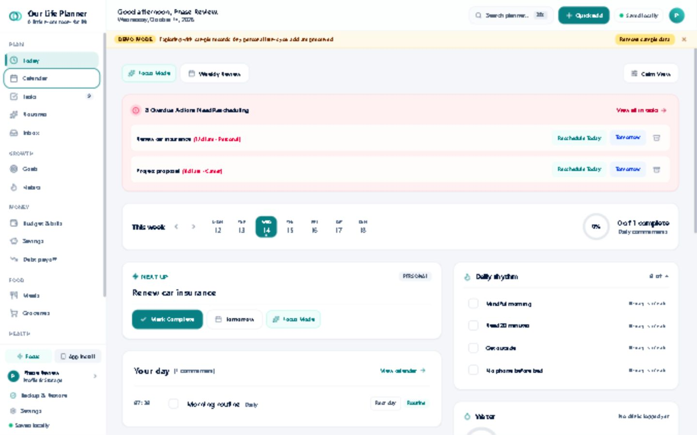
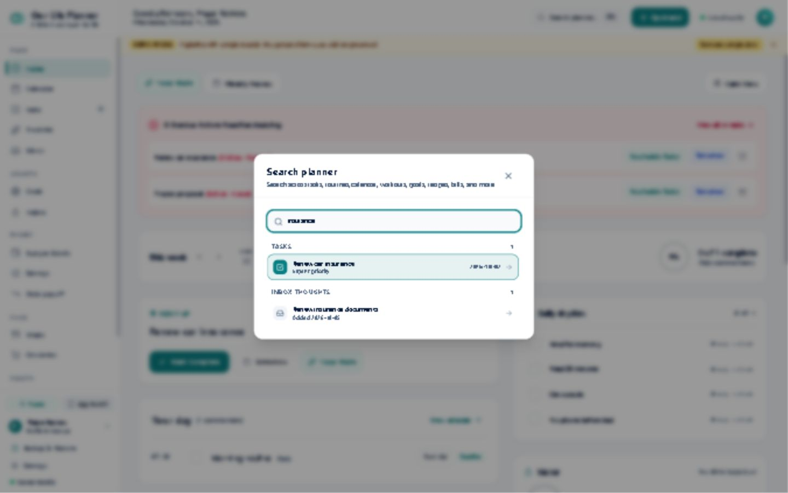
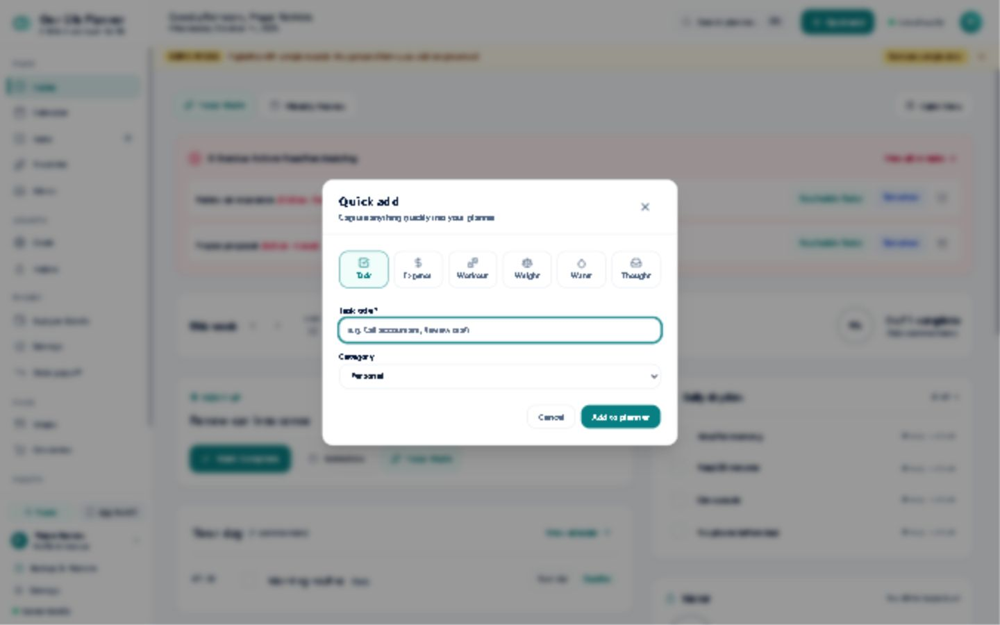
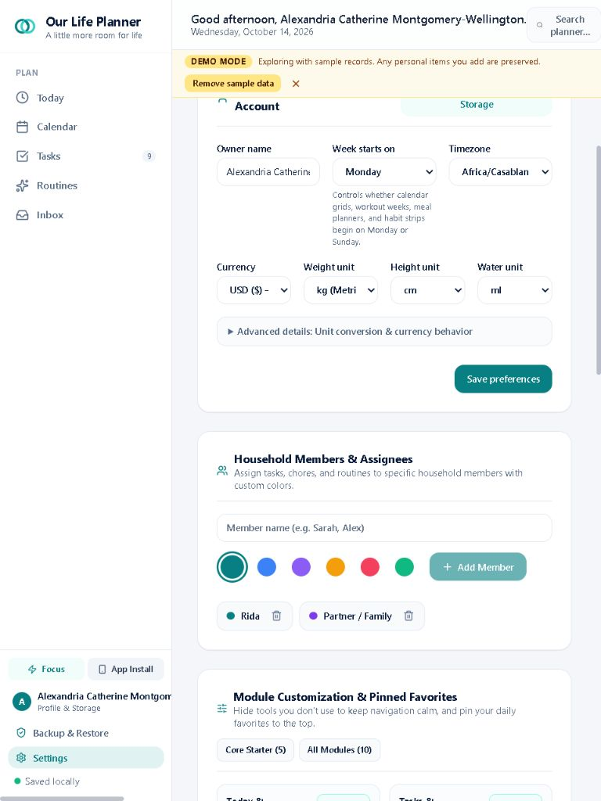
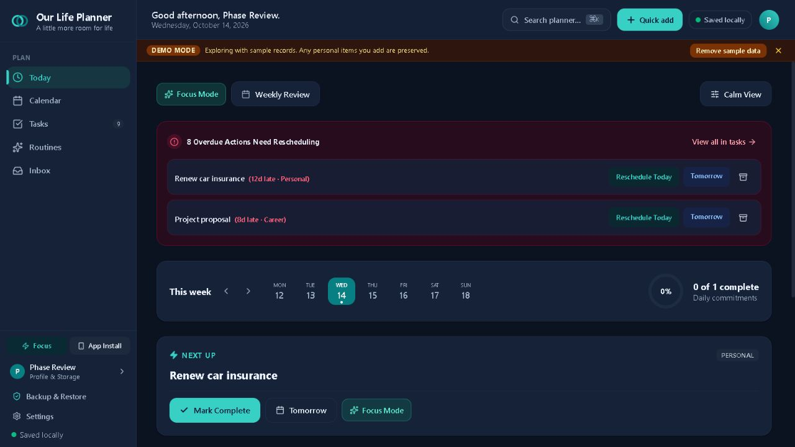
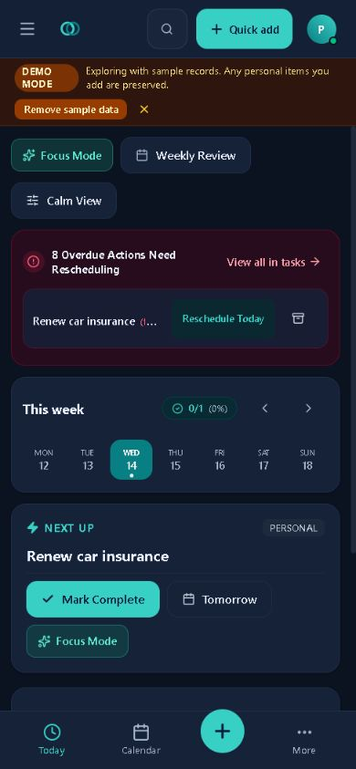
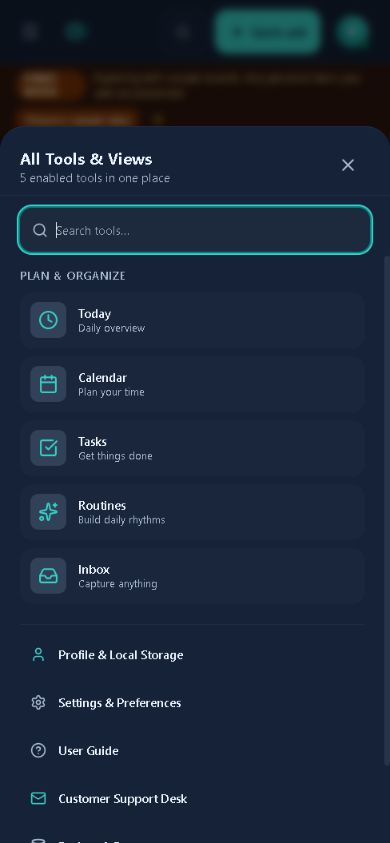
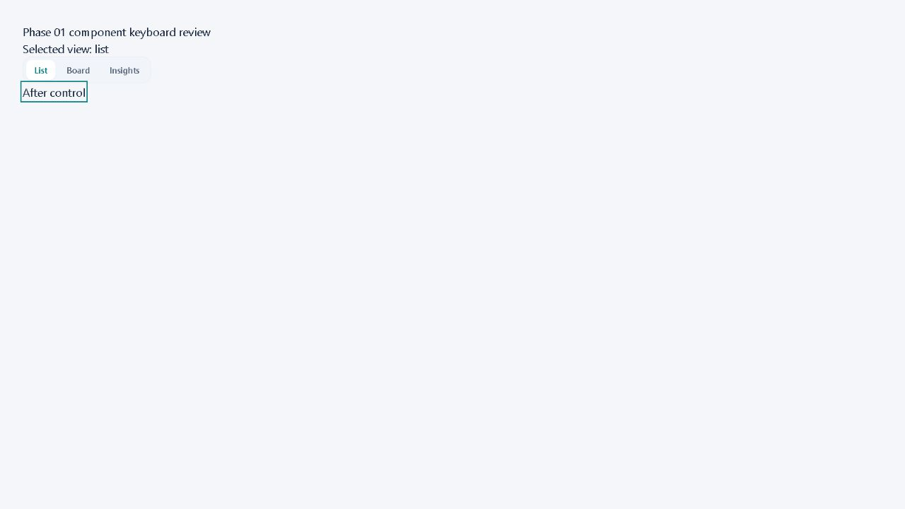

# Phase 00 and 01 review — October 14, 2026

**Decision:** retain the phase 00 baseline and the phase 01 implementation, but complete a small foundation correction pass before expanding the UI further. Three reproducible issues prevent an unconditional phase 01 sign-off.

## Revision and review scope

- Repository: [ridahidsi07/our-life-planner](https://github.com/ridahidsi07/our-life-planner).
- [Phase 00: b011b1e](https://github.com/ridahidsi07/our-life-planner/commit/b011b1e3211a5bdb953b98062809c3350d0bca3d).
- [Phase 01: 4305abc](https://github.com/ridahidsi07/our-life-planner/commit/4305abcc25cb61a8859b08f2547e6ff09f22df34).
- GitHub's `premium-ui-upgrade` branch was at `041ecfc7258552c3f604be9a8819e3da5df70063` during this review. It already includes phase 02 Today, phase 03 Board, and phase 04 Insights. `main` remains at `6afe3ac`.
- The local checkout matched that upgrade-branch head and was clean before the review. Runtime review used an isolated source snapshot of **phase 01**, served on port 3007 with disposable browser data. The original product source was not modified.
- Header, sidebar and SegmentedControl code responsible for the findings below is unchanged between phase 01 and the inspected phase 04 head. The problems therefore still apply to the current branch.
- Phases 02–04 were checked for their presence and for persistence of these findings, not independently audited in full. Do not interpret their ledger status as a sign-off from this review.

## Phase 00 assessment

The baseline work is present and useful: checkpoint tag `baseline-checkpoint-phase00` resolves to the documented baseline, the implementation plan describes the existing architecture and delivery constraints, and all 17 listed baseline screenshots exist. The phase 00 commit changes documentation, capture tooling and evidence rather than runtime UI.

`STATUS.md` reports a successful 25-suite baseline run. This review independently reran type checking, the phase 01 production/standalone build and four targeted suites, detailed below; it did not rerun all 25 suites or independently verify every baseline backup-protection claim. The baseline is sufficient to continue work, with that distinction preserved in reporting.

## Findings to fix

### R1 — P2: keep header actions inside the viewport with long names

Location: [Header.tsx, line 59](../../src/components/layout/Header.tsx#L59); also inspect the flex containers around lines 37, 58 and 69. [Pinned source](https://github.com/ridahidsi07/our-life-planner/blob/4305abcc25cb61a8859b08f2547e6ff09f22df34/src/components/layout/Header.tsx#L59).

Reproduction: save `Alexandria Catherine Montgomery-Wellington` as the owner name, then view the app at 768×1024. The greeting occupies approximately 429 px of a 548 px header. Quick Add starts at x≈779, storage status at x≈870 and profile at x≈951, outside a 768 px viewport. These controls become unavailable visually. The sidebar profile also produces horizontal overflow with the long name.

The new `truncate` class applies no-wrap behavior, but its parent flex items are not allowed to shrink appropriately. Adding truncation to the heading alone does not constrain its width.

Fix: make the greeting region shrinkable with a defined flex allocation and `min-width: 0` through the relevant ancestors. Reserve width for the action group, simplify its labels at tighter widths, and constrain the sidebar profile text. Validate 768/1024/1280 px widths, short/long names and 200% zoom. Keep search, creation, save status and profile reachable.

### R2 — P2: the new segmented control cannot change selection with a keyboard

Location: [SegmentedControl.tsx](https://github.com/ridahidsi07/our-life-planner/blob/4305abcc25cb61a8859b08f2547e6ff09f22df34/src/components/ui/SegmentedControl.tsx#L42).

The component gives inactive tabs `tabIndex={-1}` and exposes `role="tablist"`/`role="tab"`, but implements only `onClick`, with no arrow-key navigation. In a review-only fixture rendering the unchanged component, ArrowRight leaves focus/selection on List, and Tab jumps directly to the button after the control. Board and Insights cannot be reached by ordinary keyboard navigation.

This is a **latent shared-component defect**: no production caller of SegmentedControl was found in the inspected branch. It is not a claim that the existing Tasks view's separate tab implementation is broken. Fix the primitive before adopting it elsewhere.

Implement a complete tab keyboard model and appropriate relationships, or use a button-group model whose options remain keyboard reachable if these are not actual tabs. Add a real interaction test covering option changes and focus. The [WAI-ARIA tabs pattern](https://www.w3.org/WAI/ARIA/apg/patterns/tabs/) describes navigation between tabs.

### R3 — P2: new sidebar section labels have insufficient contrast

Location: [Sidebar.tsx](https://github.com/ridahidsi07/our-life-planner/blob/4305abcc25cb61a8859b08f2547e6ff09f22df34/src/components/layout/Sidebar.tsx#L176); the Favorites label near line 133 uses the same treatment.

The labels are 10 px. Browser-computed foreground/background values give:

| Mode | Foreground | Background | Calculated contrast |
|---|---|---|---|
| Light | `#8A99AD` | `#FFFFFF` | 2.90:1 |
| Dark | `#64748B` | `#152238` | 3.35:1 |

These informative labels fall below the 4.5:1 threshold for normal text. [W3C contrast guidance](https://www.w3.org/WAI/WCAG22/Understanding/contrast-minimum.html)

Use a more readable semantic text token in both themes; modestly larger labels would also improve scanning. Measure the actual resulting colors. This is a confirmed contrast finding for these labels, not a full accessibility compliance assessment of the product.

### R4 — P3: correct verification evidence and the next-phase link

The committed `keyboard-focus-sidebar-1440x900.png` and `desktop-1440x900-all-modules-light.png` are byte-identical (SHA-256 `6cdece902a6476090dab9bdaf4f0df63e4a6aba26fe8aec1ffa4e7219b2e2d8d`). The capture script near line 293 calls `.focus()` after pointer actions and does not assert `:focus-visible`. That image therefore does not prove visible keyboard focus.

Fresh keyboard input during this review **did** show a visible focus outline on the Calendar sidebar button. The defect is in the evidence, not a claim that sidebar keyboard focus is absent. Capture genuine Tab navigation, assert the focused control and focus-visible state, then retain a screenshot showing it.

The current handoff at `STATUS.md:60` references `prompts/05-drawers.md`, which does not exist. The actual next feature prompt is `prompts/05-capture-and-details.md`. Update the handoff and distinguish tests actually run from broader unverified requirements.

## Design progress and remaining planned work

The narrower 220 px sidebar, named groups, active marker and consistent 64 px header are real improvements. Search produces relevant results, Quick Add opens correctly and restores focus after closing, and core-only navigation hides optional groups. Mobile navigation and its tools menu remain usable in the reviewed 390×844 state.

Phase 01 is a foundation pass, so the old Today composition in its screenshots is expected; phase 02 contains the later dashboard work. Do not redo that work based on the historical screenshots here.

Two design debts should stay visible in the plan: profile/storage information still appears in both the header and sidebar, and several new primitives hardcode colors rather than consuming the parallel CSS token/class definitions. Address duplication intentionally, and consolidate role-based styling before the full accent work in phase 08. These are follow-up polish/maintenance items, separate from R1–R3.

## Independent checks

Commands ran on the phase 01 source snapshot using the already installed local dependencies. Vite reported 8.3.4; this is not a recreation of the historical dependency installation.

| Check | Result |
|---|---|
| `npm.cmd run lint` | Pass, exit 0. |
| `npm.cmd run build` | Pass, exit 0; production build and standalone generation complete. |
| `test-module-visibility.ts` | 22 passed, 0 failed. |
| `test-dialog-accessibility.ts` | 25 passed, 0 failed. |
| `test-tab-sync-coordinator.ts` | 14 passed, 0 failed. |
| `test-backup-validation.ts` | 54 passed, 0 failed. |
| Fresh browser checks | Confirmed sidebar/header sizes, actual keyboard focus, search results, Quick Add open/close/return focus, core-only navigation, light/dark label colors, mobile tools menu, header overflow and segmented keyboard failure. |
| Inspected browser error log | No entries reported during the observed app session. |

The four suites total **115 passing checks**. Their success does not cover the newly found header and segmented-control cases. Build warnings concern existing bundle size and future Vite config-loader compatibility; they are not new build failures.

This review did not repeat the full 25-suite release command, offline/network-disabled file workflows, all modules' business workflows, assistive-technology testing, or a full audit of phases 02–04. Generated standalone HTML is build-verified here, not newly certified as fully working offline.

Test logs and the isolated reproduction fixture are retained under `design-artifacts/phase00-01-review/` in the parent workspace. Product-ready evidence is copied into `artifacts/premium-ui/review-phase00-01/`.

## Captured steps and visual evidence

1. **Desktop shell and keyboard focus — mostly healthy.** Correct shell dimensions and visible keyboard focus; labels need stronger contrast.

2. **Search — healthy in the checked flow.** Typing insurance returns both a task and an inbox item.

3. **Quick Add entry — healthy in the checked flow.** Existing category choices and task form open; closing restores focus to the trigger. This check did not re-exercise every submission category.

4. **Long-name tablet header — needs correction.** Quick Add, saving status and profile are beyond the visible right edge.

5. **Core-only dark navigation — functional, contrast needs correction.** Optional groups hide correctly; the Plan label is too faint.

6. **Mobile shell — healthy for the phase 01 scope.** Search, creation, profile and bottom navigation remain reachable. Later Today work is outside this historical screenshot.

7. **Mobile tools menu — healthy in the checked flow.** Enabled tools and Settings remain accessible.

8. **Isolated shared segmented control — keyboard failure confirmed.** Focus skips from List to After control; this fixture is review tooling, not a shipped screen.

## Next move

Execute [NEXT-MOVE-AFTER-REVIEW.md](NEXT-MOVE-AFTER-REVIEW.md) on the current `premium-ui-upgrade` branch. Fix R1–R3, correct R4, and preserve phases 02–04. Then review those already-implemented phases against their acceptance criteria before starting the next feature phase, 05 capture/details.
