# Our Life Planner — premium UI upgrade brief

Reference: [Code & Chill's Fernly project management reel](https://www.instagram.com/reel/DeZWrkYoqOi/). Reviewed October 13, 2026.

**Main recommendation:** improve composition, information hierarchy, connected feedback, and consistency before adding more features. Your planner already has much of the necessary foundation. The reference feels polished because its components work together across screens.

## Scope and evidence

The entire 30-second visual sequence was inspected through 60 extracted frames at half-second intervals, with larger frames checked for details. Timestamps below are approximate. The source video is 1440 × 2560; the central app presentation was cropped to 1440 × 810 for inspection. These are frames from the original reel, not recreated mockups.

The comparison uses fresh screenshots of the current local `our-life-planner build`: Today, Quick Add, Tasks, Insights, Calendar, and Settings. A separate local demo session at port 3001 was initialized with all modules enabled. This makes the broad navigation visible; the default core-only configuration is less crowded. This is a focused comparison, not a full functional or accessibility audit of every planner module. Application source was read but not changed.

Exact source fonts, CSS dimensions, colors, animation durations, backend behavior, keyboard support, and refresh persistence cannot be established from a reel. Numerical design targets below are recommendations, not measurements of the original implementation. Music was not part of this UI review.

## The complete reel sequence

| Step | Time | What visibly happens | Assessment and lesson |
|---|---|---|---|
| 1 | 0–1 s | Dashboard cards, bar chart and gauge appear progressively; numbers count up to 24 total, 10 ended, 12 running, 2 pending, and 42% ended. | Strong hierarchy and coordinated entry. Avoid making users wait for long count-up animations on every visit. |
| 2 | 1–3.5 s | Add Project opens a small centered dialog with project name and due date. Payment Gateway is entered, submitted, and added to the list. Total changes 24→25, pending 2→3, and progress 42%→40%. A small confirmation appears. | Strong cause-and-effect feedback. The percentage changes consistently with 10/24 rounded versus 10/25. |
| 3 | 4–7 s | The presentation zooms into the dark patterned timer. Play changes to pause and elapsed seconds advance. | Clear operational state and a distinctive visual anchor. The zoom is presentation treatment, not a reason to zoom the real app. |
| 4 | 7.5–10.5 s | Tasks opens as a four-column board. A task is lifted, dragged to Done and settled. The target column is tinted and outlined, counts change, and completed cards show a full progress line and struck-through titles. | Strong direct manipulation. The displayed help also mentions a menu alternative, but its operation is not demonstrated. |
| 5 | 11–13 s | Team opens as member cards. The Design filter is selected; two matching cards rearrange into place. | Strong visual continuity during filtering. Useful for household assignees only if this matches actual planner use. |
| 6 | 13–15 s | A member profile opens in a white drawer from the right over a dimmed page, showing open/done/load figures and assigned tasks, then closes. | Strong context preservation. Focus trapping, Escape and focus restoration remain unverified for the reference. |
| 7 | 15.5–18.5 s | Calendar opens with month cells, event chips, selected-day agenda and Coming up list. Next month is selected; Today returns to the current month. | Clear overview plus detail. Do not infer selecting arbitrary days or editing events from this demonstration. |
| 8 | 19–23.5 s | Analytics shows four metric cards with sparklines, a throughput area chart, a project-time donut, and partially visible activity/contributor sections. A date range changes; chart hover reveals a crosshair, marker and detailed tooltip. | Rich, useful inspection. Metric animations contain intermediate values; compare settled states rather than treating each frame as new data. |
| 9 | 24–28 s | Settings shows an internal navigation list, profile form, then Appearance. Accent choices are Forest, Ocean, Plum and Ember. Ocean changes to Plum; a confirmation appears. Sunday/Monday controls are visible but not changed. | Coherent customization. The screen says the accent is remembered on the device, but no reload tests that claim. |
| 10 | 28.5–30 s | Dashboard returns with purple accents across the logo, navigation marker, primary card, buttons, bars, gauge, timer and sidebar promotion. Counts settle at 25/10/12/3, the gauge returns to 40%, and the timer is still active. | Strong cross-page consistency and visible continuity of the session. Refresh or multi-device persistence is not demonstrated. |

## Visual evidence in flow order

### 1. Dashboard structure

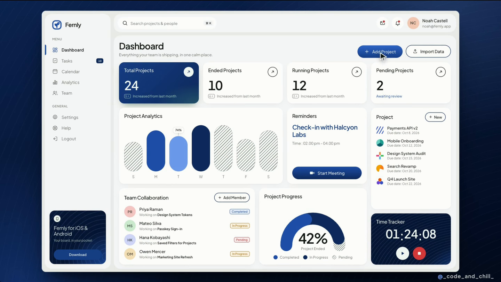

The narrow labeled sidebar and separate rounded top bar stay in place across the reel. The content begins with a page title, one-line explanation and right-aligned actions. Four equal summary cards establish an overview. The first card is dark blue with a subtle tonal gradient; the other three are light. Circular arrow controls sit in matching positions.

Below, cards have deliberately different spans: a wide analytics chart, a smaller reminder, a tall project list, a collaboration list, a semicircular progress gauge and a dark timer. Repeated edges, gaps, padding and corner treatment make the different content feel related.

### 2. Compact creation

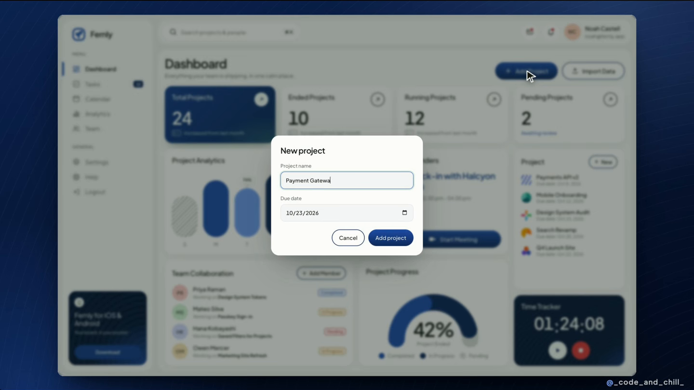

The modal has a short title, persistent labels, two fields, a visible input focus treatment and right-aligned Cancel/Add actions. The background stays recognizable through dimming and blur. It is small because the task is small.

### 3. Timer interaction

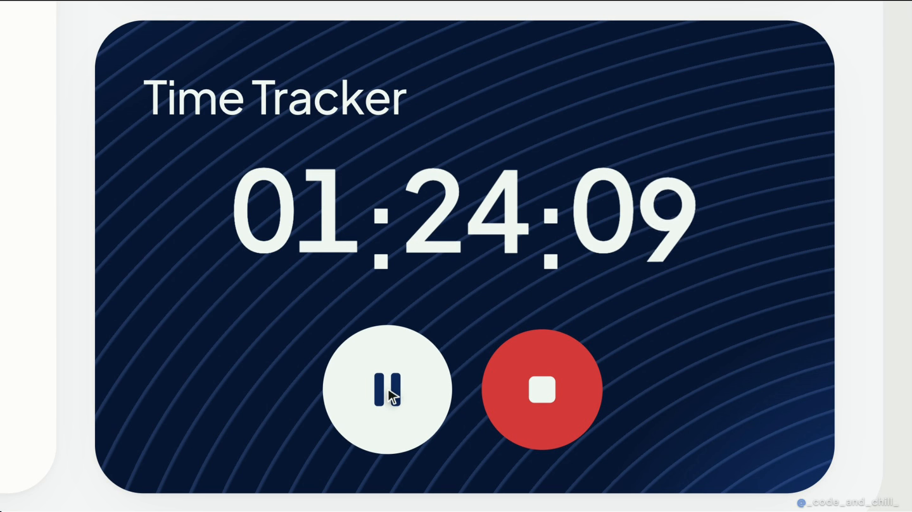

Large stable-width digits dominate a dark panel. A pale circular play/pause button and a red circular stop button communicate separate actions. Fine curved lines provide texture without adding another content element.

### 4. Task movement

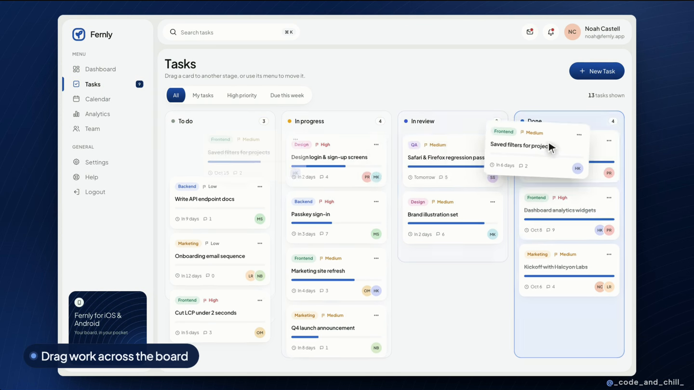

Task cards contain a category pill, priority, title, progress line, due information, comment count, assignee avatars and a restrained overflow menu. Column titles include status markers and counts. During movement, the source position remains legible, the floating card gains elevation, and the destination becomes explicit.

### 5. Team filter

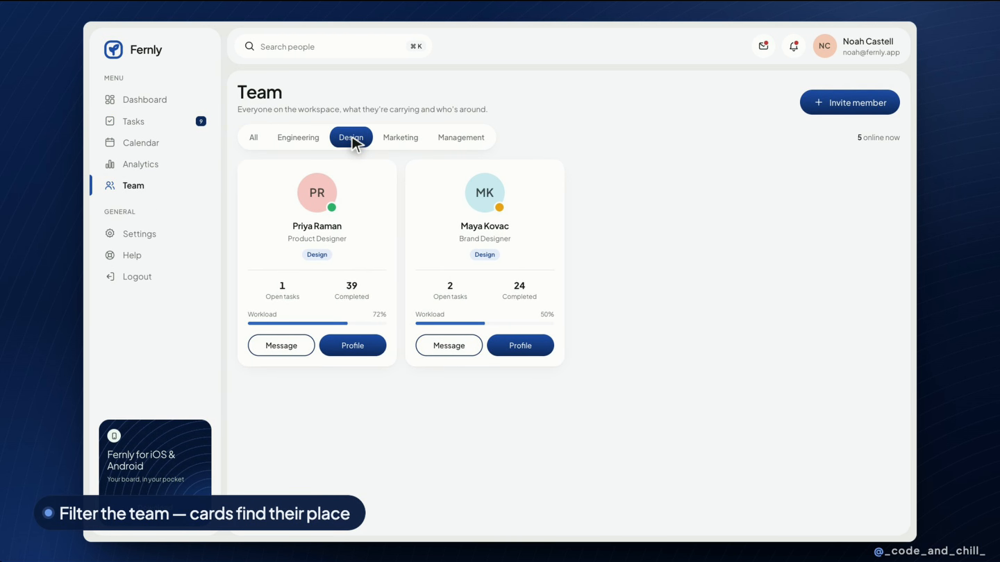

The segmented filter is a compact horizontal control. Member cards use avatar initials, presence indicators, role labels, open/completed counts and workload bars. Filter changes reorganize existing cards instead of creating a disconnected new page.

### 6. Contextual drawer

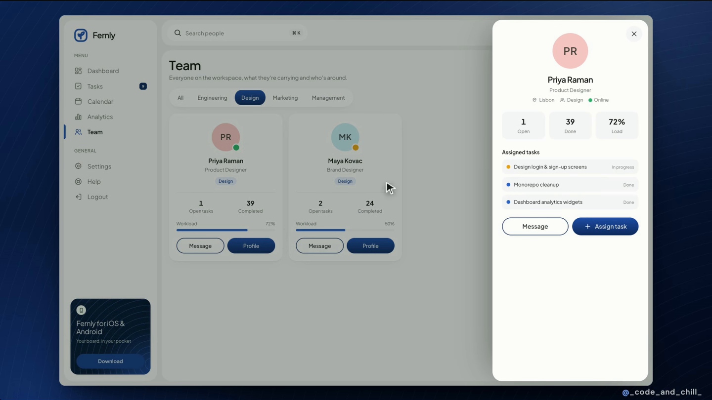

The drawer preserves the page behind it. The person's identity comes first, then a small metric row, then assigned tasks and actions. Its slide direction communicates where the panel came from.

### 7. Calendar

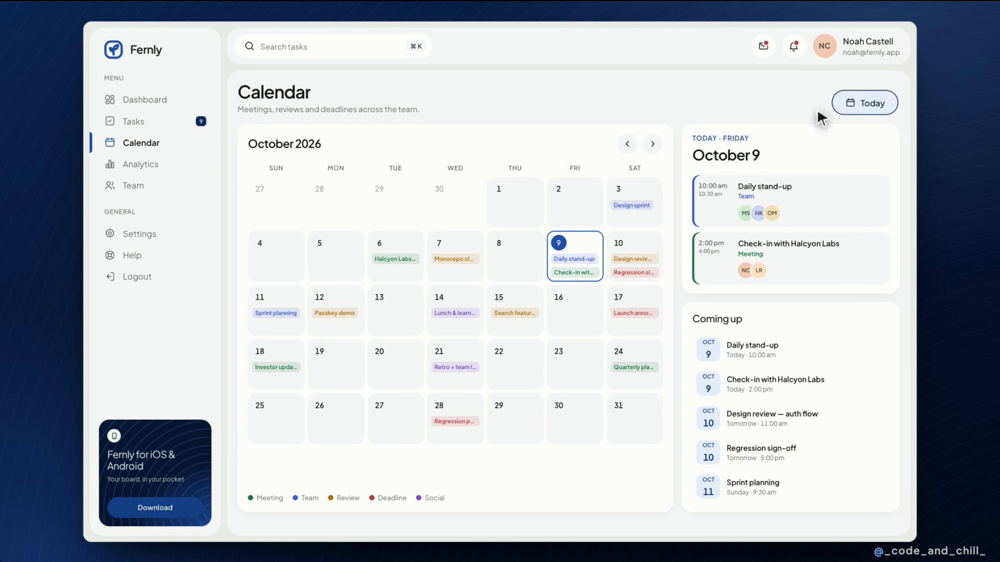

The month grid takes the larger area. Two smaller right-hand cards show the selected day and upcoming items. Muted cell backgrounds, short event labels, color coding and a clear selection outline carry the hierarchy.

### 8. Analytics and inspection

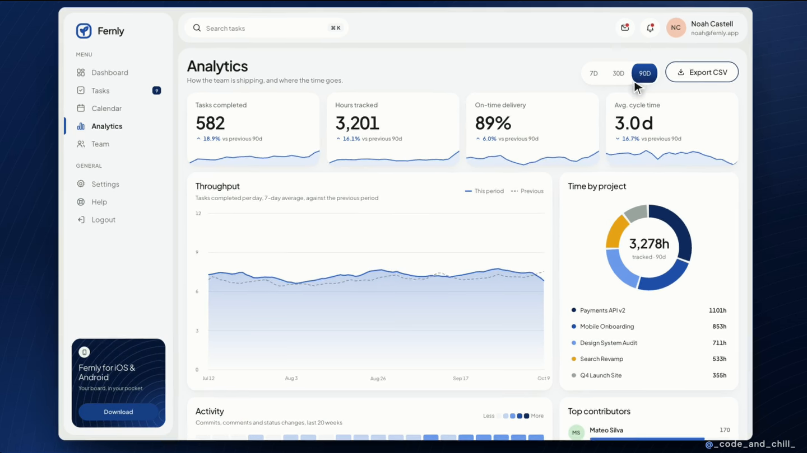

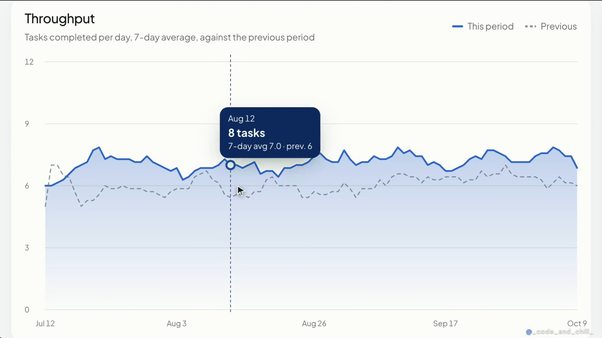

The overview combines large values, units, previous-period comparisons and small sparklines. The main chart uses a solid current-period line, a dashed comparison line, subtle horizontal guides and a translucent area fill. Hover reveals a dark tooltip and vertical crosshair. A separate donut has a center total and a legend with values.

### 9. Appearance

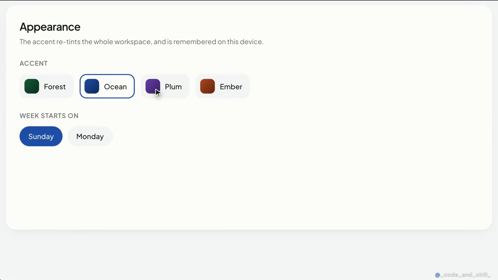

The accent selector presents named swatches and a selection outline. Settings has its own small navigation area, keeping unrelated forms out of the same long page.

### 10. Themed dashboard and preserved session

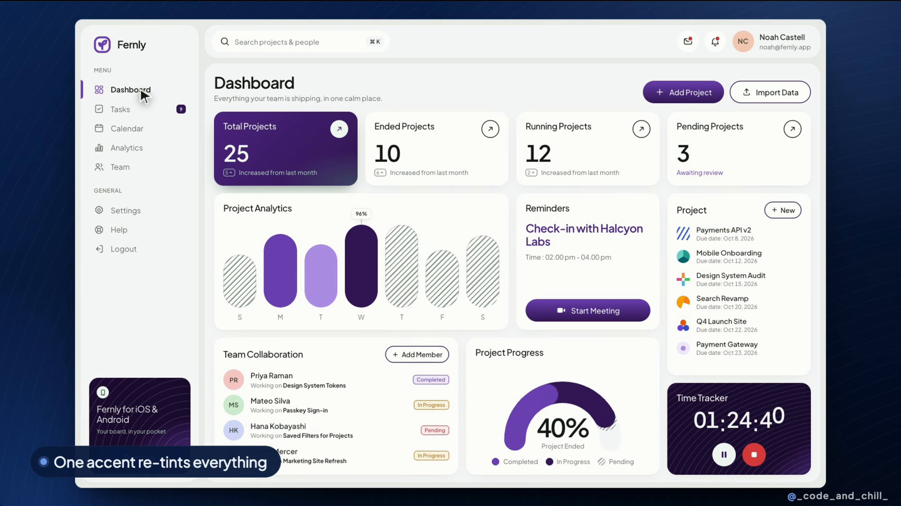

The original component hierarchy survives the color change. The same color roles carry through the whole app, while destructive controls and category identifiers keep their meaning.

## What your planner already has

- A 256 px desktop sidebar, a 64 px persistent top header, global search, Quick Add and profile controls.
- Consistent Lucide icons, light/dark surface tokens, rounded cards, status badges and tabular-number utilities.
- A working centered Quick Add dialog with focus treatment. This is already close in structure to the reel.
- Task summary cards, a List/Insights switch, calendar month/week/day views and selected-day detail.
- Progress rings and state-derived daily summaries.
- A reusable `ContextualDetailPanel`, already used for tasks, calendar and groceries. Extend its visual consistency and coverage rather than introducing a second drawer system.
- Existing CSS motion for dialogs, drawers, checks, filters and progress rings, plus reduced-motion handling. The next step is coordinated transitions and exit behavior, not simply adding animation everywhere.

## Concrete changes, in priority order

### Priority 1 — composition and hierarchy

| # | Change | Application to Our Life Planner | Done when |
|---|---|---|---|
| 1 | Reduce navigation competition | Retain labeled navigation. Group Plan, Money, Food and Health; use expandable groups and existing favorites/module preferences. Try 216–224 px width. | Essential daily tools and Settings fit comfortably; all-module users can find secondary tools without a long undifferentiated list. |
| 2 | Keep the persistent top bar, refine its hierarchy | Preserve search, Quick Add and profile. Reduce duplicated profile/storage emphasis between header and sidebar. Put the current page title in the content area. | Search and creation are always easy to find; utility controls do not compete with the page task. |
| 3 | Reclaim the first screen | Compact the overdue panel into a count and primary action with expandable details. Combine the week selector and progress summary into a smaller toolbar. | At 1280×720, users see the page identity, key figures and meaningful task content without scrolling past large control regions. |
| 4 | Create a four-card Today overview | Suggested metrics: commitments today, completed, needs attention and weekly consistency. Show clear date scopes and respect enabled modules. | Figures are useful, non-duplicative and open the relevant filtered view. |
| 5 | Give one card stronger contrast | Use a dark navy or deep brand-color treatment on daily progress or Next Up. Keep the other summary surfaces light. | The eye finds the main priority immediately. This change does not require replacing your teal brand everywhere. |
| 6 | Use varied card spans | Make schedule/Next Up the larger column, and habits, a small trend and focus controls supporting cards. Place less urgent money/health summaries lower or behind customization. | Cards share grid edges and gutters, but their size reflects importance and content. |
| 7 | Reduce boxes inside boxes | Remove the need for a large standalone card around every page heading and toolbar. Use spacing and typography where a boundary adds no information. | Main content begins higher, with fewer competing outlines. |
| 8 | Establish one spacing scale | Use a small set of gaps/paddings rather than individually chosen values. Suggested baseline: 8/12/16/24/32 px. | Similar components align on every page; compactness comes from structure, not tiny text. |
| 9 | Strengthen typography | Use a consistent neutral sans-serif, readable secondary text, clear page titles and larger metric figures. Reduce excessive uppercase micro-labels. | Title, value, task name and metadata are distinguishable at a glance. |
| 10 | Refine surfaces and controls | Use a neutral tinted canvas, light cards, subtle boundaries and small soft shadows. Standardize corner radii and primary/secondary/tertiary button styling. | Comparable controls have equal heights, padding and icon size. Hover, focus and pressed states are distinct. |

### Priority 2 — data and useful interactions

| # | Change | Application to Our Life Planner | Done when |
|---|---|---|---|
| 11 | Upgrade Insights into visual analysis | Keep the existing counts, but add a weekly completion chart, category breakdown and trend comparison where history exists. | Users can answer what changed and where attention is needed; charts are not decoration. |
| 12 | Add chart inspection | Date ranges, labeled axes, units, legend, marker/crosshair and concise tooltips. Provide equivalent focus/tap access. | Values and time periods are clear without guessing from a shape or color. |
| 13 | Make summaries and charts agree | Compute cards, progress, badges and lists from shared records and the same filter scope. | One completion or creation changes every relevant display consistently. |
| 14 | Distinguish real changes from animated numbers | Briefly interpolate an actual old/new metric, using fixed-width numerals and stable layout. Avoid arbitrary changing demo values. | The final value is correct; animations do not reset everything to zero on routine navigation. |
| 15 | Add an optional Board view | Place it alongside List and Insights. Use existing planner statuses: Not started, In progress, On hold and Completed, rather than adding an unrelated review workflow. | Moving a card updates task state and counts; the table remains available. |
| 16 | Design the full drag interaction | Show a lifted card, original slot, clear drop target, smooth settling and cancellation. Add a menu/keyboard way to change status. | Movement remains usable without a mouse and cannot silently lose or duplicate tasks. |
| 17 | Improve task information hierarchy | Task title first; quiet category/status badges; concise due information; initials for assignee; overflow actions. Show progress only for tasks that have meaningful subtasks. | A task is scannable without many equally prominent chips and action icons. |
| 18 | Extend the existing detail drawer | Reuse the task/calendar/grocery drawer foundation for consistent viewing/editing of contextual details. Add purposeful sections and a clear footer action. | Closing returns to the same list/filter/scroll position; entry and exit are both polished. |
| 19 | Keep Quick Add focused | Preserve your current modal. From a specific module, open directly to its relevant form. Keep global Quick Add categories, with secondary fields progressively revealed. | Common capture takes very few decisions; errors stay beside the relevant field. |
| 20 | Couple save feedback to the result | Close after success, show a small confirmation, reveal/highlight the new row and update related summaries. Offer Undo for reversible actions where appropriate. | Users can identify what changed and recover without hunting. |
| 21 | Make desktop calendar cells more informative | Your month cells currently show colored dots. Where space allows, add one or two short event labels and a +N more control. Keep compact dots for smaller layouts. | Users can understand an upcoming day without opening each cell. |
| 22 | Improve the agenda alongside the calendar | Keep the existing selected-day panel; add a compact upcoming list and concise date formatting. | The selection, displayed agenda and date-navigation state agree. |
| 23 | Bring focus timing into the working context | Consider a compact timer card or persistent mini-controller linked to the existing Focus feature. Use dark treatment, stable digits and explicit start/pause/stop. | Timing continues coherently across navigation and the current state is obvious. |
| 24 | Adapt people features only where useful | For family planning, use member avatars, assignment filters and optional member summaries. Avoid importing a business team directory into a solo planner. | These features reduce coordination effort instead of adding unused UI. |

### Priority 3 — a consistent finish

| # | Change | Application to Our Life Planner | Done when |
|---|---|---|---|
| 25 | Animate filtering as a layout change | Preserve item identity and animate cards into their new positions; use a subtle selected-filter transition. | Users follow what remained, moved or disappeared without losing context. |
| 26 | Coordinate page transitions | Keep sidebar/header stable while content changes. Use short staggered entry only where it clarifies grouping; finish leaving states cleanly. | No distracting blank flash, content jump or long delay before interaction. |
| 27 | Add a complete accent system | Extend existing variables into coordinated accent, hover, pale surface, deep surface, chart series and focus roles. Replace component-level hardcoded teal where it prevents theming. | A single accent choice reaches navigation, buttons, charts, rings, dialogs and special cards in both light and dark modes. |
| 28 | Preserve semantic colors | Keep warning, error, success, overdue and destructive roles distinct from the user's chosen accent. | A purple theme does not make an error look like a normal selected control. |
| 29 | Restructure Settings | Group General, Appearance, Household, Modules and Data into local navigation or clear sections. | Users reach the relevant preference without scrolling through every unrelated form. |
| 30 | Add selective texture | Use a very faint line/contour motif on a focus card or one featured surface. | Texture reinforces identity without reducing text contrast or appearing on every card. |
| 31 | Improve demo composition | Generate sample dates relative to the current date so the demo stays representative. Keep the demo label and an easy clear option. | A future visit does not make most sample tasks overdue merely because their dates were fixed in October 2026. |
| 32 | Finish real-world states | Design empty, loading, error, disabled, saving, success, long-name and large-number cases with the same care. | The product still looks coherent when the ideal sample data disappears. These states are not demonstrated by the reel. |
| 33 | Carry the design onto smaller screens | Collapse navigation, stack summary cards and use appropriate sheets/full-screen details while retaining readable targets and chart access. | The same information hierarchy works on phone and tablet. The reel provides no mobile proof. |

## Recommended starting values

These are implementation targets to tune against real content, not exact values extracted from the reel.

| Design decision | Starting point |
|---|---|
| Sidebar | 216–224 px labeled desktop navigation; optional compact mode with clear labels/tooltips |
| Header | Keep the existing 64 px height; align its controls consistently |
| Page padding | 24–32 px desktop, 16 px mobile |
| Card gaps | 16 px, with 24 px between major sections |
| Card padding | 16–20 px; consistent across comparable cards |
| Card radius | 16–20 px; smaller related radius for fields and row surfaces |
| Page title / section title | About 26–30 px / 16–18 px |
| Primary metric / body / metadata | About 32–40 px / 14–16 px / 12–13 px |
| Compact contextual modal | About 420–480 px; retain more width when global category controls need it |
| Detail drawer | About 400–480 px desktop; adapt on narrow screens |
| Hover / press feedback | About 120–160 ms |
| Modal / drawer transition | About 180–240 ms; retain reduced-motion support |
| Filter rearrangement | About 200–300 ms, with small travel distances |
| Optional metric interpolation | About 300–450 ms, only when it helps explain an actual update |

Use your existing navy `#071A3A` and teal `#087F83` as a valid foundation. The reel's quality does not require blue to be the only accent. Exact reference font and color identification remains unverified.

## Current planner evidence

### Today — main opportunity: first-screen balance

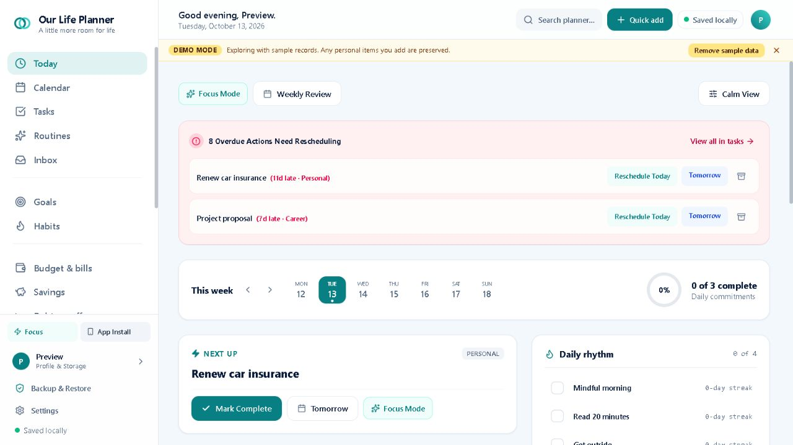

The header, demo banner, action row, large overdue block and week strip appear before most working content. Compacting these regions would yield a larger improvement than adding decorative effects. The long sidebar shown here reflects all modules being enabled.

### Quick Add — preserve and refine

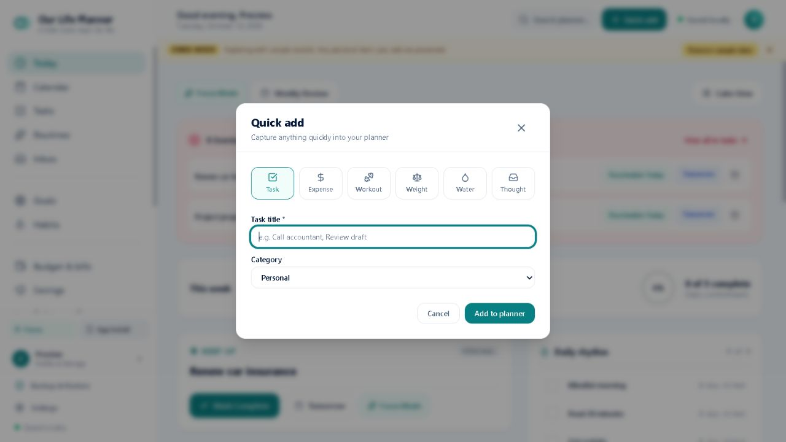

The modal already uses a dimmed/blurred backdrop, focus treatment and clear actions. Contextual entry and consistent sizing are more valuable than a full replacement.

### Tasks — add an optional working mode

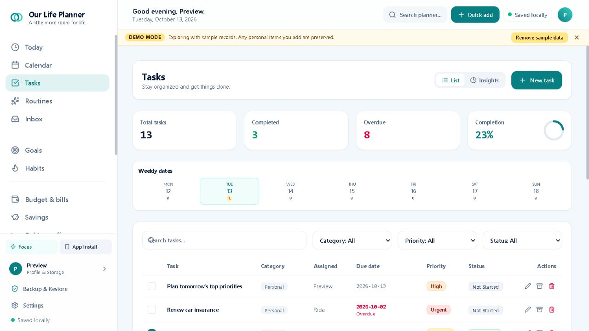

The existing summary cards and task table are useful. The large week strip and separate heading surface consume vertical space. A Board mode would add the reference's direct manipulation without removing List.

### Insights — add patterns and change over time

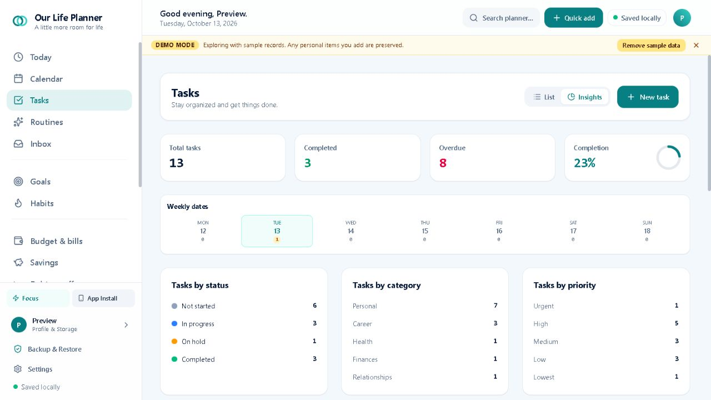

The first Insights region is mostly categorical counts. A trend chart with comparison and useful inspection would communicate more than these lists alone. This is not a claim that every planner module lacks charts.

### Calendar — extend the existing overview/detail structure

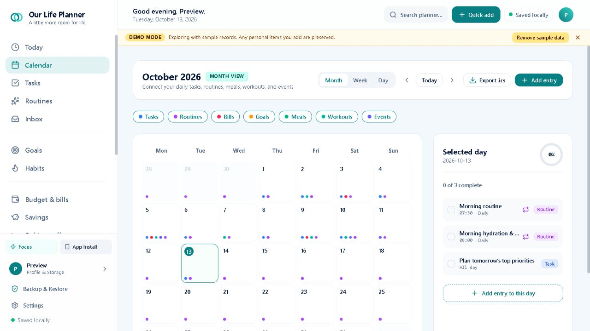

The selected-day side panel already follows the reference's useful pattern. Text event chips, restrained color usage and a compact upcoming list would make the month more immediately readable.

### Settings — improve findability

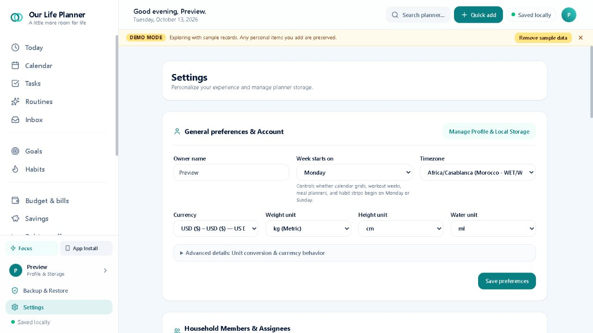

The form is orderly, but the settings experience continues through many sections. Local section navigation would make Appearance, Modules, Household and Data easier to reach.

## Suggested implementation sequence

1. Recompose Today and simplify navigation; keep existing behavior and module preferences.
2. Standardize typography, spacing, featured-card treatment and shared surface/button styles.
3. Improve chart content and connect metric transitions to real updates.
4. Add optional task Board interactions and refine the existing detail drawers and contextual creation.
5. Extend accent tokens, reorganize Settings, and finish transitions, responsive layouts and non-ideal states.

## Source locations for implementation

Paths below are relative to `our-life-planner build`.

| Area | Existing source |
|---|---|
| Navigation and header | `src/components/layout/Sidebar.tsx`, `Header.tsx` |
| Today composition | `src/components/today/TodayDashboard.tsx` |
| Tokens, surfaces and motion | `src/index.css` |
| Task modes and analytics | `src/components/tasks/TasksView.tsx` |
| Creation | `src/components/modals/QuickAddModal.tsx` |
| Dialog and drawer behavior | `src/components/ui/Modal.tsx`, `ContextualDetailPanel.tsx` |
| Calendar and agenda | `src/components/calendar/CalendarView.tsx` |
| Appearance and preferences | `src/components/settings/SettingsView.tsx` |
| Shared state and derived values | `src/context/PlannerContext.tsx` and existing calculation utilities |

## Limits and patterns to treat carefully

- The reel contains edited zooms, captions, a patterned presentation background and a watermark. Those belong to the promotional video and should not become everyday app UI.
- Very small gray text and tiny controls may look elegant at video scale, but their actual contrast and target sizes need implementation-level checks. Do not reduce readability to match a compressed video.
- The chart's patterned bars and percentages look distinctive, but their precise metric semantics are not fully explained. Label your own charts clearly rather than copying ambiguity.
- The recorded blank/faded transition frames show that even the reference is not flawless. Preserve interaction readiness and avoid resetting every figure on each page visit.
- No error submission, empty state, keyboard traversal, refresh persistence, offline recovery, mobile layout, or screen-reader behavior was demonstrated in the reel. These remain product requirements to validate independently.
- Screenshots and source inspection confirm the foundations listed here, not complete accessibility compliance or production readiness.
